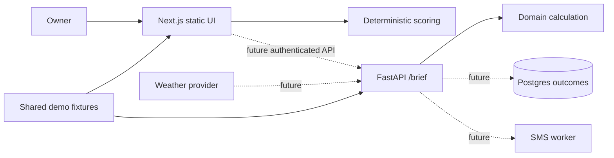

# Architecture

GitHub Pages hosts only the static frontend. The tested FastAPI service is not deployed. Frontend and backend deliberately implement the same documented formula against one shared fixture. Production should move the formula to the API, version it with each brief, and use contract vectors to prevent drift.

**Failure paths:** invalid weather is rejected (client domain error/API 422); unknown spot is API 404; empty history must block a personalized call and fall back to a labeled market baseline; upstream weather failure must retain the last timestamped forecast and suppress auto-send when stale; persistence/SMS failures must be retried idempotently and surfaced in an operations queue.

**Security/operations:** tenant-scoped authorization, encrypted POS tokens, minimized sales data, input bounds, rate limiting, audit events for brief and override, dependency scanning, daily send-success/error metrics, stale-weather alert, and a runbook for forecast/SMS outages.
